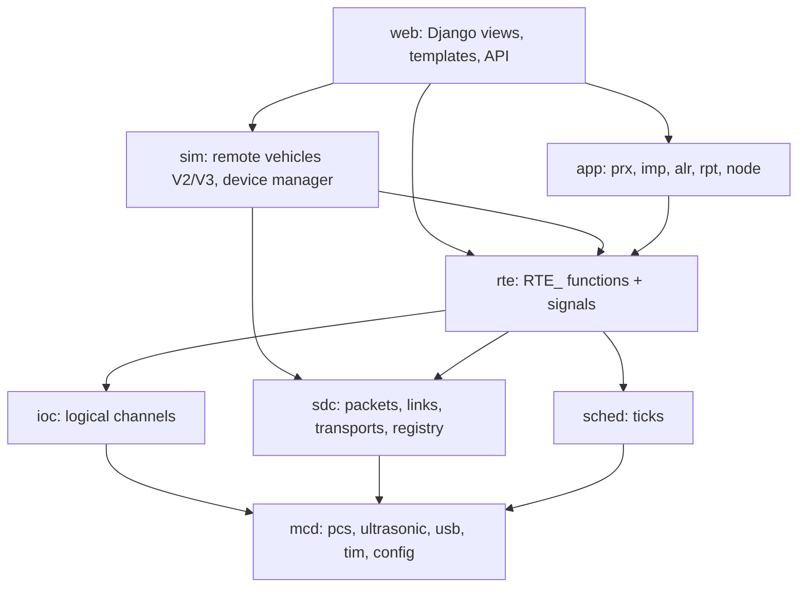
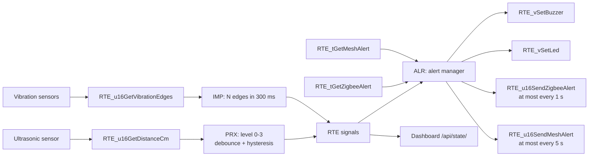

# Architecture

## Layers and dependency rules

The code follows the AUTOSAR-style layering of lab L3. The RTE (lab L5) is the only way the application reaches the
hardware.

| Layer | May import | Notes |
| --- | --- | --- |
| `mcd` | nothing from the project, no Django | GPIO, ultrasonic, serial, timers |
| `ioc`, `sdc`, `sched` | `mcd` | `sdc` also uses pyserial and meshtastic |
| `rte` | `ioc`, `sdc`, `sched` | `rte/sim_support.py` holds the simulation hooks |
| `app` | `rte` and the standard library | pure logic, time is an argument, so it is testable with a fake clock |
| `sim` | `rte`, `sdc` | |
| `web` | `rte`, `app`, `sim` | views never touch hardware |

Nothing imports upward. `tests/test_layers.py` parses every import with `ast` and fails when a rule is broken.

## Data flow

**Distance to level.** `PRX` converts the distance to a level: clear above 150 cm, caution up to 150, warning up to 80,
danger up to 30 (boundaries inclusive). A level change needs 3 consecutive agreeing samples, and going to a lower
level needs 5 cm of margin. Invalid readings keep the previous level for 1 s, then the level falls back to 0 and a
sensor-fault flag is set.

**Vibration to impact.** `IMP` declares an impact when at least 3 edges arrive within 300 ms, holds the impact flag for
2 s, and ignores new impacts for a 3 s lockout.

**Alert outputs.** Level 1 beeps 200 ms in every 1000 ms, level 2 200 ms in every 500 ms, level 3 is continuous. An
impact gives 2 s of continuous buzzer and a rapidly flashing LED. A remote alert gives two short beeps and keeps the LED
on for 5 s. While the level is 2 or higher, or an impact occurred, alerts are sent over Zigbee at most once per second
and over Meshtastic at most once per 5 seconds (LoRa airtime is scarce).

## Alert packet

One format on both radios, little endian, 14 bytes:

| Offset | Size | Field | Meaning |
| --- | --- | --- | --- |
| 0 | 1 | type | `0x01` = alert |
| 1 | 1 | seq | 8-bit sequence number, wraps 255 to 0 |
| 2 | 1 | kind | 1 = proximity, 2 = impact |
| 3 | 1 | level | 0 clear, 1 caution, 2 warning, 3 danger |
| 4 | 2 | distance_cm | u16 |
| 6 | 4 | node_id | sender id |
| 10 | 4 | hmac | HMAC-SHA256 over bytes 0-9, truncated to 4 bytes |

Over Zigbee (a byte stream in XBee transparent mode) the packet is wrapped as
`0x7E 0xA5 | length | packet | crc8` (18 bytes), so a receiver can resynchronize after garbage or a partial read.
Over Meshtastic the 14 bytes travel as the payload of one Meshtastic packet, far below the 233-byte limit.

Trade-offs:

- A 4-byte tag keeps the frame small, but it only gives 32 bits of forgery resistance. That is acceptable for a
  warning-only demonstration; it is not a security design.
- The key is shared (`MESH_HMAC_KEY`). Anyone with the key can forge alerts.
- Replay protection is kept per sender node id: a packet is accepted only if its sequence number is newer than the
  last one from that node, inside a window of 128 with 8-bit wrap-around. Equal or older numbers are dropped, which also means a sender that
  restarts at seq 0 may be ignored until it passes the old value.
- The CRC of the Zigbee frame only detects line noise; authenticity is decided by the HMAC.

## Threading model

- ONE runtime thread (`app/node.py`, started from `web/apps.py`) calls `NODE_vStep()` every 100 ms. It is the only
  code that talks to the hardware: sensors, buzzer, LED, radios.
- Django request threads never touch hardware. They read RTE signals and the runtime status, or enqueue a request
  (for example a buzzer pulse of at most 2 s) that the runtime thread executes.
- Radio receive does not block: the Meshtastic library calls back into a queue; `poll()` drains it.
- Signals live in a lock-protected dictionary, so any thread may read them.
- Buzzer and LED are forced off when the runtime thread stops, on an error, at normal exit and on SIGTERM (systemd stop).
- `manage.py runserver` starts the autoreloader's parent and child processes; the runtime starts only in the child (or
  with `--noreload`), and never for `manage.py test` or `check`.

## Zigbee and LoRa Meshtastic

| | Zigbee (XBee3) | LoRa Meshtastic (Heltec V3) |
| --- | --- | --- |
| Range | short: tens of metres, nearby vehicles | long: kilometres, control centre |
| Rate | fast, alert at most every 1 s | very slow, alert at most every 5 s |
| Link | USB serial, 9600 baud, transparent mode, own framing | stock Meshtastic firmware, USB serial or TCP 4403 |
| Use | warn the vehicle behind or beside you | report to a distant point |

Both carry the same signed packet, and both links expose the same function names, so the application treats them
identically.

## What is simulated when hardware is missing

- `MCD_SIMULATE=1`, or no `lgpio` / no `/dev/gpiochip*`: GPIO is memory. The buzzer and LED are flags, the ultrasonic
  distance is a settable value (default 300 cm) and vibration edges can be injected. Nothing real is measured.
- No XBee found: the Zigbee link uses `SimulatedTransport` and reports `"simulated": true`; the dashboard shows
  `SIMULATED`.
- No Meshtastic modem found (or simulation on): same for the Meshtastic link.
- Remote vehicles V2 and V3: with `SIM_V2_*` / `SIM_V3_*` set they transmit over real LoRa from the extra boards;
  without them the packet is produced by the same code and put into the Pi's simulated receive queue, and the result says
  `simulated: true`. Zigbee scripted vehicles work only while the Pi's Zigbee link is simulated.
- Every simulated part is labelled on the dashboard. No dummy data is shown: before the first measurement the distance is
  empty.
