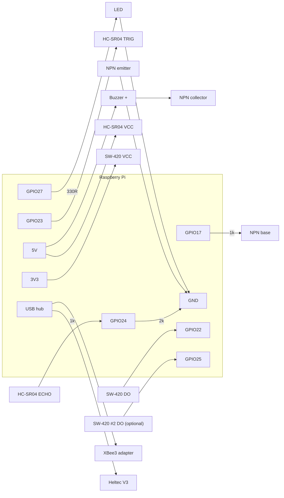

# Hardware

This is all the hardware the project uses. There is no GPS and no accelerometer.

## Bill of materials

| Qty | Part | Notes |
| --- | --- | --- |
| 1 | Raspberry Pi 4 (development) or Pi 5 (target) | Raspberry Pi OS, user in `dialout` and `gpio` groups |
| 1 | Ultrasonic sensor HC-SR04 (or compatible, 5 V) | TRIG, ECHO, VCC, GND |
| 1 | Resistors 1 kOhm and 2 kOhm | ECHO voltage divider |
| 1 | Active buzzer, 5 V | on/off only (no PWM) |
| 1 | NPN transistor (2N2222 or BC337), 1 kOhm base resistor, small diode (1N4148) across the buzzer | buzzer driver |
| 1 | LED and 330 Ohm resistor | visual alert |
| 1-2 | Vibration sensor module, digital output (for example SW-420) | impact detection; the second one is optional |
| 1 | XBee3 Zigbee module + USB adapter | 9600 baud, transparent mode |
| 1 | Heltec WiFi LoRa 32 V3 | the Pi's own LoRa Meshtastic modem, USB |
| 1 | Heltec e-ink Meshtastic board | simulated remote vehicle V2 |
| 1 | Seeed XIAO (nRF52840) Meshtastic board | simulated remote vehicle V3 |
| 1 | Powered USB hub, breadboard, jumper wires | the hub keeps USB radios stable |

## Pin table

| Pin | Signal type | Signal name | Definition |
| --- | --- | --- | --- |
| GPIO17 (pin 11) | DOP | BUZZER | 1 kOhm to NPN base; active buzzer between 5 V and collector; protection diode |
| GPIO27 (pin 13) | DOP | LED | LED with a 330 Ohm resistor to GND |
| GPIO23 (pin 16) | DOP | US_TRIG | ultrasonic TRIG, 10 us trigger pulse |
| GPIO24 (pin 18) | DIP | US_ECHO | ultrasonic ECHO through the voltage divider; high time = distance |
| GPIO22 (pin 15) | DIP | VIB1 | vibration sensor 1, impact pulses counted as edges |
| GPIO25 (pin 22) | DIP | VIB2 | optional vibration sensor 2 |
| 5V (pin 2) | PWR | 5V | ultrasonic VCC and buzzer supply |
| 3V3 (pin 1) | PWR | 3V3 | vibration modules (3.3 V logic) |
| GND (pin 6) | PWR | GND | common ground |
| USB (powered hub) | COM | ZIGBEE | XBee3 adapter, 9600 baud |
| USB (powered hub) | COM | MESHTASTIC | Heltec V3, 115200 baud |

The same table is defined in code as `PIN_TABLE` in `mcd/config.py`.

## Wiring



```text
ECHO voltage divider (HC-SR04 ECHO outputs 5 V, the Pi pin tolerates only 3.3 V):

   ECHO ----[ 1 kOhm ]----+----> GPIO24
                          |
                      [ 2 kOhm ]
                          |
                         GND            GPIO24 sees 5 V x 2/3 = about 3.3 V
```

### ECHO voltage divider

Never connect ECHO directly to GPIO24: 5 V can damage the Pi. Use 1 kOhm in series from ECHO to the pin, and 2 kOhm
from the pin to GND. TRIG may be driven directly from 3.3 V; the sensor accepts it. The sensor VCC is 5 V.

Timing note: the driver measures the echo pulse in software, so the result jitters by about +-1-2 cm. Valid range is
2-400 cm; anything else is reported as invalid.

### Buzzer driver

GPIO17 drives the base of an NPN transistor through 1 kOhm. The active buzzer sits between 5 V and the collector; the
emitter goes to GND. Put a small diode across the buzzer (cathode to 5 V) to absorb switching spikes. The buzzer is on/off only.

### Vibration sensors

Use modules with a digital output (SW-420 type). Connect VCC to 3.3 V (so the output stays at 3.3 V logic), GND to GND,
DO to GPIO22 (and the optional second module to GPIO25). The software counts edges, not levels, because an impact
produces short bursts of pulses. Set the sensitivity with the module's potentiometer: a good setting stays quiet when the
vehicle is parked and pulses on a knock. With only one sensor fitted, set `MCD_VIB2=0`.

## LoRa Meshtastic boards (Heltec V3, Heltec e-ink, Seeed XIAO)

All three run the **stock** Meshtastic firmware. No custom firmware is needed.

1. Open https://flasher.meshtastic.org in Chrome or Edge, connect the board by USB, select the device and the latest
   stable firmware, and flash it (the page is free and runs in the browser).
2. In the Meshtastic app or web client set the **region to `EU_868`**.
3. Use the **same channel** (same name and key) on every node: the project profile expects the preset `LONG_FAST` and the channel
   name `VEH`.
4. Roles in this project:
   - Heltec V3: the Pi's own modem, connected to the Pi by USB.
   - Heltec e-ink = remote vehicle V2, Seeed XIAO = remote vehicle V3. Connect them to the Pi by USB or enable WiFi on the board
     and use TCP port 4403, then set `SIM_V2_PORT` / `SIM_V2_HOST` and `SIM_V3_PORT` / `SIM_V3_HOST` in `.env`.
5. Use a quality antenna, and never power the board without one attached.

## XBee (Zigbee) setup

Configure the modules with Digi XCTU (a free tool from Digi) before using them:

- Firmware: XBee3 Zigbee 3.0.
- The **same PAN ID (`ID`)** on every module.
- One module is the coordinator (`CE` = Enabled); the others are routers or end devices that join its network.
- `AP` = 0 (transparent mode) and `BD` = 3 (9600 baud) on the module attached to the Pi.

Without an XBee the Zigbee link runs in simulation and the dashboard shows `SIMULATED`.

## Finding the serial ports

Names like `/dev/ttyUSB0` depend on the plug order: the XBee adapter and the Heltec V3 can both appear as
`ttyUSB0`. The software therefore identifies the devices by their vendor and product strings:

```bash
ls -l /dev/serial/by-id/
```

Typical entries: `usb-FTDI_...` or `usb-Digi_...` is the XBee adapter; `usb-Silicon_Labs_CP2102...` is the Heltec V3 (CP210x
bridge); `usb-Espressif...` is the e-ink board; `usb-Seeed...` is the XIAO. The Devices page of the dashboard shows what was
detected and how each device was classified.

If two candidates match (for example two FTDI adapters) the program does not guess: it reports the port as
"ambiguous" and you set `ZIGBEE_PORT` and/or `MESHTASTIC_PORT` in `.env` to the full `/dev/serial/by-id/...` path.
Add the user to the `dialout` group to access serial ports: `sudo usermod -aG dialout $USER`.
