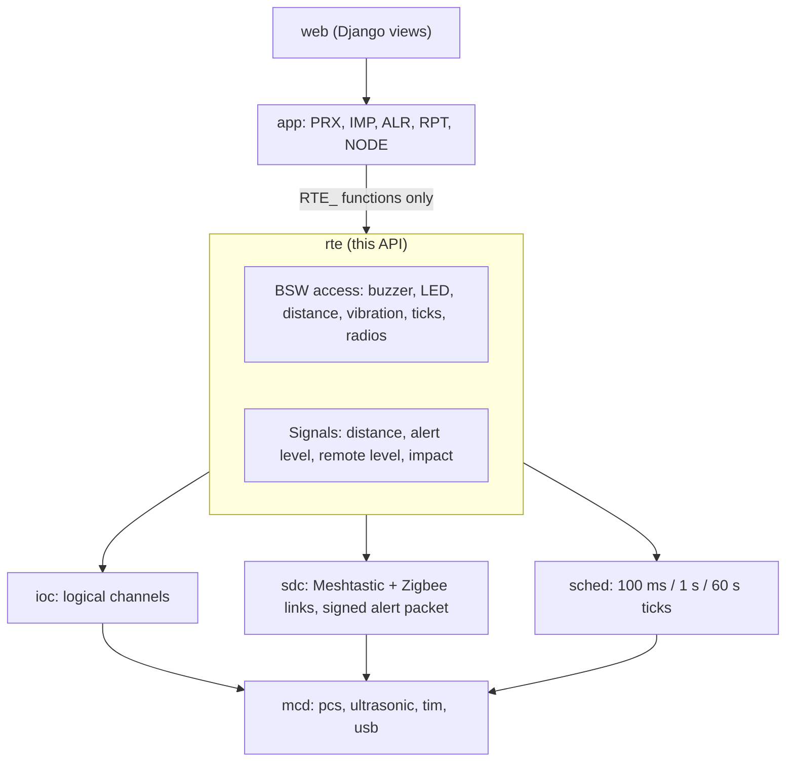

# RTE API (lab L5)

The RTE is the only interface the application layer uses to reach the BSW and to exchange signals between
application modules. It makes the application independent of the hardware: the same APP code runs on the Raspberry Pi
and on a laptop in simulation.

Conventions:

- Prefixes: `v` = void, `u8` / `u16` = unsigned 8 / 16 bit, `b` = bool, `t` = tuple/dict.
- Binary values are in the interval 0-1 and only real ints are accepted (bool, float, None, str, 2 and -1 are rejected).
- Invalid parameters are **ignored**: the output or signal does not change and no exception is raised.
- "Reentrant: Yes" means the function can be called from several threads at the same time (the state is lock protected
  or serialized by the driver). In the running system hardware access is still done by ONE runtime thread.
- Constants: `RTE_DISTANCE_INVALID = 0xFFFF`, `RTE_KIND_PROXIMITY = 1`, `RTE_KIND_IMPACT = 2`, `RTE_LEVEL_MAX = 3`,
  `RTE_MESH_TEXT_MAX_BYTES = 200`.

## How the RTE connects APP and BSW

Two kinds of RTE function:

1. **BSW access** (lifecycle, buzzer, LED, distance, vibration, ticks, radios): translate an application request into IOC /
   SDC / SCHED calls. APP never imports `mcd`, `ioc`, `sdc` or `sched`.
2. **Signals** (`RTE_vWrite*` / `RTE_u*Read*`): a lock-protected store that works as the virtual functional bus. PRX writes the
   distance, IMP writes the impact flag, ALR writes the levels, and ALR / RPT / the web views read them, so application
   modules never call each other directly.

Function groups: Lifecycle (2), BSW outputs (2), BSW inputs (4), Timing (3), LoRa Meshtastic (4), Zigbee (3), Signals (virtual functional bus) (8). Total: 26 functions.

## Lifecycle

### `RTE_vInit`

| Field | Value |
|---|---|
| Name | `RTE_vInit` |
| Description | Initializes IOC (GPIO, ultrasonic pins, vibration edge counters), starts the 100 ms / 1 s / 60 s timers, creates and connects the LoRa Meshtastic and Zigbee links. Buzzer and LED start off. Calling it twice is safe (the second call does nothing). |
| Parameters | none |
| Return value | void |
| Reentrant | No |

### `RTE_vDeinit`

| Field | Value |
|---|---|
| Name | `RTE_vDeinit` |
| Description | Buzzer and LED off (always, even if a later step fails), closes both radio links, stops the timers, releases IOC/GPIO and resets all signals to their defaults. Safe without a prior init. |
| Parameters | none |
| Return value | void |
| Reentrant | No |

## BSW outputs

### `RTE_vSetBuzzer`

| Field | Value |
|---|---|
| Name | `RTE_vSetBuzzer` |
| Description | Switches the buzzer (GPIO17 through the NPN transistor) on or off. Invalid values are ignored. |
| Parameters | **u8Value** (u8): 0 = off, 1 = on (real int only). Interval: 0-1 |
| Return value | void |
| Reentrant | Yes |

### `RTE_vSetLed`

| Field | Value |
|---|---|
| Name | `RTE_vSetLed` |
| Description | Switches the LED (GPIO27) on or off. Invalid values are ignored. |
| Parameters | **u8Value** (u8): 0 = off, 1 = on (real int only). Interval: 0-1 |
| Return value | void |
| Reentrant | Yes |

## BSW inputs

### `RTE_u16GetDistanceCm`

| Field | Value |
|---|---|
| Name | `RTE_u16GetDistanceCm` |
| Description | Performs one ultrasonic measurement and returns the distance. Returns RTE_DISTANCE_INVALID when there is no echo or the target is out of range. |
| Parameters | none |
| Return value | Type: u16. Distance in cm, or 0xFFFF if invalid. Interval: 2-400, 0xFFFF |
| Reentrant | Yes |

### `RTE_u8GetDistanceSensorStatus`

| Field | Value |
|---|---|
| Name | `RTE_u8GetDistanceSensorStatus` |
| Description | Tells whether the last distance measurement was valid. |
| Parameters | none |
| Return value | Type: u8. 1 = last measurement valid, 0 = invalid or none yet. Interval: 0-1 |
| Reentrant | Yes |

### `RTE_u16GetVibrationEdges`

| Field | Value |
|---|---|
| Name | `RTE_u16GetVibrationEdges` |
| Description | Returns the number of vibration edges counted on all vibration inputs since the previous call and clears the count. |
| Parameters | none |
| Return value | Type: u16. Edge count since the previous call. Interval: 0-65535 |
| Reentrant | Yes |

### `RTE_u8GetVibrationState`

| Field | Value |
|---|---|
| Name | `RTE_u8GetVibrationState` |
| Description | Returns the current raw level of the vibration inputs (1 if any input is high). |
| Parameters | none |
| Return value | Type: u8. Raw level. Interval: 0-1 |
| Reentrant | Yes |

## Timing

### `RTE_u8GetTick100ms`

| Field | Value |
|---|---|
| Name | `RTE_u8GetTick100ms` |
| Description | Returns 1 once per elapsed 100 ms period and consumes the event. Returns 0 if the period has not elapsed or the RTE is not initialized. Missed periods do not produce a burst. |
| Parameters | none |
| Return value | Type: u8. 1 = period elapsed (event consumed), 0 = not yet. Interval: 0-1 |
| Reentrant | Yes |

### `RTE_u8GetTick1s`

| Field | Value |
|---|---|
| Name | `RTE_u8GetTick1s` |
| Description | Returns 1 once per elapsed 1 s period and consumes the event. Returns 0 if the period has not elapsed or the RTE is not initialized. Missed periods do not produce a burst. |
| Parameters | none |
| Return value | Type: u8. 1 = period elapsed (event consumed), 0 = not yet. Interval: 0-1 |
| Reentrant | Yes |

### `RTE_u8GetTick60s`

| Field | Value |
|---|---|
| Name | `RTE_u8GetTick60s` |
| Description | Returns 1 once per elapsed 60 s period and consumes the event. Returns 0 if the period has not elapsed or the RTE is not initialized. Missed periods do not produce a burst. |
| Parameters | none |
| Return value | Type: u8. 1 = period elapsed (event consumed), 0 = not yet. Interval: 0-1 |
| Reentrant | Yes |

## LoRa Meshtastic

### `RTE_u8GetMeshStatus`

| Field | Value |
|---|---|
| Name | `RTE_u8GetMeshStatus` |
| Description | Tells whether the LoRa Meshtastic modem link is connected (a simulated link counts as connected). |
| Parameters | none |
| Return value | Type: u8. 1 = connected, 0 = not connected or not initialized. Interval: 0-1 |
| Reentrant | Yes |

### `RTE_u16SendMeshAlert`

| Field | Value |
|---|---|
| Name | `RTE_u16SendMeshAlert` |
| Description | Builds a signed alert packet (14 bytes) and sends it over LoRa Meshtastic. Invalid arguments or no link: nothing is sent. |
| Parameters | **u8Kind** (u8): 1 = proximity, 2 = impact. Interval: 1-2 **u8Level** (u8): Alert level: 0 clear, 1 caution, 2 warning, 3 danger. Interval: 0-3 **u16DistanceCm** (u16): Distance in cm. Interval: 0-65535 |
| Return value | Type: u16. Bytes sent, 0 on invalid arguments or no link. Interval: 0-65535 |
| Reentrant | Yes |

### `RTE_u16SendMeshText`

| Field | Value |
|---|---|
| Name | `RTE_u16SendMeshText` |
| Description | Sends a short text over LoRa Meshtastic (device test). Empty, non-string or too long text is refused. |
| Parameters | **text** (str): Text to send, 1-200 UTF-8 bytes. Interval: 1-200 bytes |
| Return value | Type: u16. Bytes sent, 0 on invalid text or no link. Interval: 0-200 |
| Reentrant | Yes |

### `RTE_tGetMeshAlert`

| Field | Value |
|---|---|
| Name | `RTE_tGetMeshAlert` |
| Description | Returns the oldest valid received Meshtastic alert and removes it from the queue. Packets with a bad signature, wrong length or a replayed/older sequence number are dropped and never returned. Does not block. |
| Parameters | none |
| Return value | Type: t. dict {node, kind, level, distance_cm, seq}, or None if nothing valid was received. Interval: node u32, kind 1-2, level 0-3, distance_cm u16, seq 0-255 |
| Reentrant | Yes |

## Zigbee

### `RTE_u8GetZigbeeStatus`

| Field | Value |
|---|---|
| Name | `RTE_u8GetZigbeeStatus` |
| Description | Tells whether the Zigbee link is connected. Without an XBee the link is simulated and still counts as connected (the UI shows a SIMULATED badge). |
| Parameters | none |
| Return value | Type: u8. 1 = connected, 0 = not connected or not initialized. Interval: 0-1 |
| Reentrant | Yes |

### `RTE_u16SendZigbeeAlert`

| Field | Value |
|---|---|
| Name | `RTE_u16SendZigbeeAlert` |
| Description | Same contract as RTE_u16SendMeshAlert, over Zigbee. The packet is wrapped in a sync/length/CRC frame (18 bytes on the wire). |
| Parameters | **u8Kind** (u8): 1 = proximity, 2 = impact. Interval: 1-2 **u8Level** (u8): Alert level: 0 clear, 1 caution, 2 warning, 3 danger. Interval: 0-3 **u16DistanceCm** (u16): Distance in cm. Interval: 0-65535 |
| Return value | Type: u16. Bytes sent, 0 on invalid arguments or no link. Interval: 0-65535 |
| Reentrant | Yes |

### `RTE_tGetZigbeeAlert`

| Field | Value |
|---|---|
| Name | `RTE_tGetZigbeeAlert` |
| Description | Same contract as RTE_tGetMeshAlert, over Zigbee (frames are resynchronized after garbage or split reads). |
| Parameters | none |
| Return value | Type: t. dict {node, kind, level, distance_cm, seq}, or None. Interval: node u32, kind 1-2, level 0-3, distance_cm u16, seq 0-255 |
| Reentrant | Yes |

## Signals (virtual functional bus)

### `RTE_vWriteDistanceCm`

| Field | Value |
|---|---|
| Name | `RTE_vWriteDistanceCm` |
| Description | Stores the latest filtered distance (signal written by PRX, read by ALR/RPT/web). Invalid values are ignored. |
| Parameters | **u16Value** (u16): Distance in cm, 0xFFFF = invalid. Interval: 0-65535 |
| Return value | void |
| Reentrant | Yes |

### `RTE_u16ReadDistanceCm`

| Field | Value |
|---|---|
| Name | `RTE_u16ReadDistanceCm` |
| Description | Returns the latest stored distance. 0xFFFF until the first write and after RTE_vDeinit. |
| Parameters | none |
| Return value | Type: u16. Distance in cm. Interval: 0-65535 |
| Reentrant | Yes |

### `RTE_vWriteAlertLevel`

| Field | Value |
|---|---|
| Name | `RTE_vWriteAlertLevel` |
| Description | Stores the local alert level. Invalid values are ignored. |
| Parameters | **u8Value** (u8): Alert level. Interval: 0-3 |
| Return value | void |
| Reentrant | Yes |

### `RTE_u8ReadAlertLevel`

| Field | Value |
|---|---|
| Name | `RTE_u8ReadAlertLevel` |
| Description | Returns the local alert level. |
| Parameters | none |
| Return value | Type: u8. Alert level (0 until written). Interval: 0-3 |
| Reentrant | Yes |

### `RTE_vWriteRemoteAlertLevel`

| Field | Value |
|---|---|
| Name | `RTE_vWriteRemoteAlertLevel` |
| Description | Stores the alert level received from another node. Invalid values are ignored. |
| Parameters | **u8Value** (u8): Remote alert level. Interval: 0-3 |
| Return value | void |
| Reentrant | Yes |

### `RTE_u8ReadRemoteAlertLevel`

| Field | Value |
|---|---|
| Name | `RTE_u8ReadRemoteAlertLevel` |
| Description | Returns the alert level received from another node. |
| Parameters | none |
| Return value | Type: u8. Remote alert level (0 until written). Interval: 0-3 |
| Reentrant | Yes |

### `RTE_vWriteImpact`

| Field | Value |
|---|---|
| Name | `RTE_vWriteImpact` |
| Description | Stores the impact flag (written by IMP, read by ALR/web). Invalid values are ignored. |
| Parameters | **u8Value** (u8): 1 = impact, 0 = none (real int only). Interval: 0-1 |
| Return value | void |
| Reentrant | Yes |

### `RTE_u8ReadImpact`

| Field | Value |
|---|---|
| Name | `RTE_u8ReadImpact` |
| Description | Returns the impact flag. |
| Parameters | none |
| Return value | Type: u8. Impact flag (0 until written). Interval: 0-1 |
| Reentrant | Yes |

## L5 requirement -> where it is satisfied

| L5 requirement | Where it is satisfied |
|---|---|
| Implement the RTE functions for communication between application modules | Signals group: `RTE_vWriteDistanceCm` / `RTE_u16ReadDistanceCm`, `RTE_vWriteAlertLevel` / `RTE_u8ReadAlertLevel`, `RTE_vWriteRemoteAlertLevel` / `RTE_u8ReadRemoteAlertLevel`, `RTE_vWriteImpact` / `RTE_u8ReadImpact` (`rte/__init__.py`, lock-protected store) |
| Implement the RTE functions for access to the BSW | Lifecycle, BSW outputs, BSW inputs, Timing, LoRa Meshtastic and Zigbee groups, implemented on top of `ioc`, `sdc` and `sched` only |
| Naming `RTE_vSetX` / `RTE_u8GetX` / `RTE_u16GetX`, prefixes v / u8 / u16 / b / t | All 26 functions; checked by `DocumentationTests.test_naming_convention` in `rte/test.py` |
| Binary values and return values in the interval 0-1 | `RTE_vSetBuzzer`, `RTE_vSetLed`, `RTE_vWriteImpact`, status, tick and state getters; tests use the bad values 2, -1, 0.6, True, None, "1" |
| Invalid parameters are ignored | Every setter / writer / send function; tests `test_invalid_*` and `test_invalid_arguments_return_zero_and_send_nothing` |
| Every function documented with a table (name, description, parameters, return value, reentrancy) | This file, one table per function; `DocumentationTests` checks that the documented set equals the public functions in code |
| Unit-test file in which ALL RTE functions are tested (`unit.c`) | `rte/test.py`, one test class per function group; run `MCD_SIMULATE=1 python -m rte.test` (also found by `manage.py test`) |
| RTE makes the application independent of the hardware | APP imports only `rte`; with `MCD_SIMULATE=1` the same API runs with a simulated sensor, memory-flag outputs and simulated radios |
